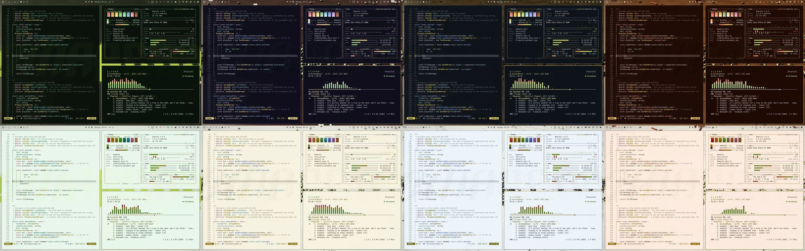
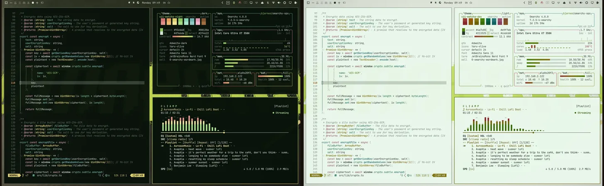
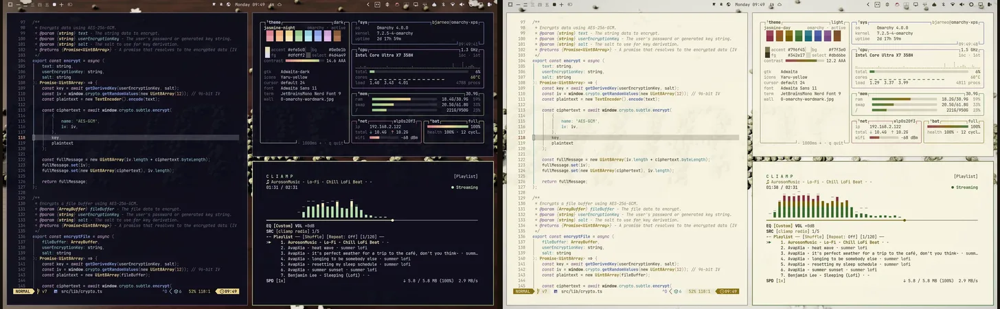
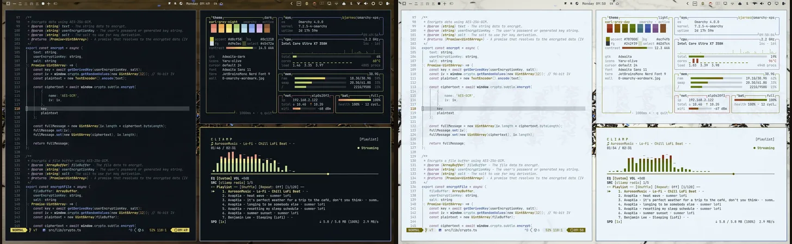
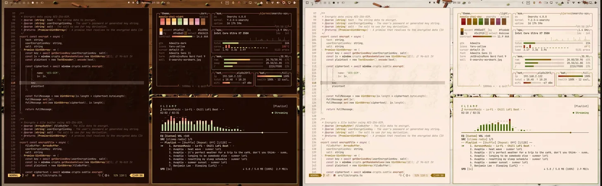

# Tea themes for Omarchy

[](https://bjarneo.github.io/tea-themes)

This repo has 4 tea themes for [Omarchy](https://omarchy.org): Uji Matcha, Jasmine, Earl Grey and Masala Chai. Each theme has a night variant and a day variant. That makes 8 Omarchy themes. Each variant has a 16-color ANSI palette, 5 backgrounds at 6K and a steam video.

- Site: [bjarneo.github.io/tea-themes](https://bjarneo.github.io/tea-themes)
- Screenshots: real captures of an Omarchy desktop with each variant applied
- Backgrounds: 40 images at 6K, 6144×3456, and 8 steam videos at 3840×2160

## Variants

| Variant | Theme name | What it is | Lowest ANSI contrast | Lowest text contrast |
| --- | --- | --- | --- | --- |
| Night | `uji-matcha-night` | A dark background in the color of the tea. For the evening and dim rooms. | 5.6:1 | 14.5:1 |
| Day | `uji-matcha-day` | A light background with the same hues. For bright rooms and daylight. | 4.5:1 | 11.9:1 |

The contrast columns show the lowest WCAG contrast ratio against the background, over all 4 themes. The script raises or lowers the lightness of each color until it reaches its target. The 6 main ANSI colors reach at least 4.5:1, the WCAG AA level. The muted color for comments reaches at least 3.8:1. Each variant is a complete Omarchy theme with its own folder, so you can install any mix of them.

## Signature palettes

All 4 teas use a signature palette. Like Osaka Jade and Miasma in Omarchy, they fill the 6 ANSI slots with the colors of the tea, so a slot can hold a color that is not its name. The red of Uji Matcha is azuki bean, the yellow of Earl Grey is bergamot, the blue of Jasmine is the night sky, and the blue of Masala Chai is the clay of the cup.

The contrast targets above apply to all slots. A check also keeps the 6 slots apart, so no 2 slots look the same.

## Backgrounds

Each variant has 6 backgrounds: 5 images and 1 video. Omarchy shows them in this order. To show the next one, run `omarchy theme bg next`.

| File | What it shows |
| --- | --- |
| `0-omarchy-wordmark.jpg` | The Omarchy wordmark spelled in the dry tea on a table: rolled leaves, jasmine pearls, whole chai spices, or matcha sifted through a stencil. |
| `1-teacup.jpg` | The tea in its cup on a table: matcha in a chawan, jasmine in a porcelain cup, Earl Grey in a teacup with a gold rim, and chai in a clay kulhad. |
| `2-brew-guide.jpg` | The brew guide: water temperature, brew time, tea, water and the steps. |
| `3-tea-swirl.jpg` | A close-up of the tea: whisked matcha foam, milk that swirls into Earl Grey or chai, or jasmine blossoms that float on the tea. |
| `4-tea-leaves.jpg` | The dry tea from a low angle with a shallow focus. |
| `5-steam.mp4` | A 12 second loop at 3840×2160. The cup seen from above, with the Omarchy wordmark in the matcha foam, in cinnamon on the chai, or on the bottom of the cup under clear tea. Steam drifts over the cup. |

The wordmark, the cup, the close-up, the leaves and the cup of the steam video are photographic renders. The GPU ray-marches each 3D scene with soft shadows, reflections and depth of field. Clear tea refracts the light, and the cup shows through it, darker with depth. The brew guide is a flat drawing.

## Install

`install.sh` copies themes into `~/.config/omarchy/themes`. Each theme variant becomes a normal Omarchy theme folder. The script installs the night and day variants of a theme unless you name one with `--variant`.

### Install one theme without a clone

The script downloads only the themes that you name:

```bash
curl -fsSL https://bjarneo.github.io/tea-themes/install.sh | bash -s -- uji-matcha --set
```

To install one variant only, add `--variant`:

```bash
curl -fsSL https://bjarneo.github.io/tea-themes/install.sh | bash -s -- uji-matcha jasmine --variant day
```

`--set` applies the first installed variant of the last theme.

### Install from a clone

```bash
git clone --depth 1 https://github.com/bjarneo/tea-themes ~/.local/share/tea-themes
cd ~/.local/share/tea-themes
./install.sh --all
omarchy theme set uji-matcha-night
```

The full repo is about 100 MB because it has 40 backgrounds at 6K. To download less, use the `curl` command above. It downloads only the folders that you name.

### Options

| Command | Result |
| --- | --- |
| `install.sh uji-matcha jasmine` | Installs the night and day variants of the named themes |
| `install.sh uji-matcha --variant day` | Installs only this variant |
| `install.sh --all` | Installs all 8 themes |
| `install.sh --list` | Lists the 4 theme names |
| `install.sh uji-matcha --set` | Installs the theme, then applies its night variant |
| `install.sh --update` | Installs again every theme variant that the script installed |
| `install.sh --remove uji-matcha` | Removes the variants of a theme that the script installed |
| `install.sh --link uji-matcha` | Links to the clone instead of copying. Run `git pull` in the clone to update. |
| `install.sh --force uji-matcha` | Replaces a theme with the same name that the script did not install |

The variant names are `night` and `day`. The script writes a `.tea-themes` marker file in each theme that it copies. `--update` and `--remove` use this file, so they never change a theme that you made.

### Apply with Aether

[Aether](https://github.com/omacom/aether) can apply a theme straight from the [site](https://bjarneo.github.io/tea-themes). Open a tea, pick a variant and a background, and select 1 of these buttons:

| Button | Result |
| --- | --- |
| Apply with Aether | Aether loads the palette and the background, then applies them at once through its own theme. |
| Install as Omarchy theme | Aether adds the variant to `~/.config/omarchy/themes` and activates it at once. This stops if a theme with the same name exists, for example after `install.sh`. |
| Open in editor | Aether opens the palette in its editor. Nothing changes until you select Apply. |

Aether stops a download after 60 seconds. On a slow connection, a 6K background can take longer, so the links download a 3840×2160 copy from `site/assets/aether/`. GitHub does not render `aether://` links, so use the site or build a link yourself:

```text
aether://apply?colors=https://bjarneo.github.io/tea-themes/uji-matcha/night/colors.toml&wallpaper=https://bjarneo.github.io/tea-themes/assets/aether/uji-matcha/night/1-teacup.jpg&silent=true
```

Add `&as_omarchy_theme=uji-matcha-night` to install the variant. Use `&edit=true` instead of `&silent=true` to open the editor.

### Name conflicts

All theme names end in `-night` or `-day`. They do not collide with the themes that ship with Omarchy, with [coffee-themes](https://github.com/bjarneo/coffee-themes) or with [100-themes](https://github.com/bjarneo/100-themes). The script does not replace a theme that it did not install. If `~/.config/omarchy/themes/uji-matcha-night` exists, the script skips it and tells you. Rename your theme, or use `--force` to replace it.

The matcha theme is called Uji Matcha, after the town where it grows. Its names are `uji-matcha-night` and `uji-matcha-day`, so they do not collide with `matcha-day` from 100-themes.

`omarchy theme install <url>` does not work with this repo. That command expects one theme at the root of a repo.

## Switch themes and backgrounds

```bash
omarchy theme set uji-matcha-night   # apply a theme
omarchy theme set uji-matcha-day     # the same tea in daylight
omarchy theme bg next                # show the next background of the current theme
```

## The teas

| Kind | Teas |
| --- | --- |
| Green tea | [Uji Matcha](#uji-matcha), [Jasmine](#jasmine) |
| Black tea | [Earl Grey](#earl-grey), [Masala Chai](#masala-chai) |

## Green tea

### Uji Matcha

[](https://bjarneo.github.io/tea-themes/#uji-matcha)

`01` · Signature palette · Origin: Uji, Japan · Folder: [`uji-matcha/`](uji-matcha/) · [Open on the site](https://bjarneo.github.io/tea-themes/#uji-matcha)

Shade-grown green tea, ground to a fine powder and whisked with hot water into a light foam. The close-up background shows the whisked foam.

| Brew | Value |
| --- | --- |
| Tea | 2 g |
| Water | 70 ml |
| Temperature | 80 °C |
| Whisk time | 15 to 30 s |
| Infusions | 1 |

| Variant | Theme name | `background` | `foreground` | `accent` | Icons |
| --- | --- | --- | --- | --- | --- |
| Night | [`uji-matcha-night`](uji-matcha/night/) | `#08120a` | `#d7e6da` | `#93cb60` | `Yaru-olive` |
| Day | [`uji-matcha-day`](uji-matcha/day/) | `#e9f7eb` | `#213325` | `#4a7c05` | `Yaru-olive` |

<details>
<summary>All 16 ANSI colors of each variant</summary>

| Variant | Normal, 0 to 7 | Bright, 8 to 15 |
| --- | --- | --- |
| Night | `#152217` `#d87972` `#8ccc66` `#e3d372` `#74b9b8` `#eb9dbb` `#8ad7b6` `#c0cfc2` | `#647767` `#e6958e` `#aae08d` `#f7ea9c` `#95cdcc` `#fab8d1` `#adebcf` `#f2f9f3` |
| Day | `#d3e6d6` `#943432` `#3f7c02` `#7e700a` `#1f7171` `#994d6d` `#006245` `#415244` | `#6e8071` `#821f20` `#356805` `#695c00` `#075f5f` `#873a5c` `#004f37` `#0c1a0f` |

</details>

```bash
curl -fsSL https://bjarneo.github.io/tea-themes/install.sh | bash -s -- uji-matcha --set
```

### Jasmine

[](https://bjarneo.github.io/tea-themes/#jasmine)

`02` · Signature palette · Origin: Fujian, China · Folder: [`jasmine/`](jasmine/) · [Open on the site](https://bjarneo.github.io/tea-themes/#jasmine)

Green tea scented with fresh jasmine blossoms, which open at night. The leaves are rolled into pearls. The close-up background shows jasmine blossoms that float on the tea.

| Brew | Value |
| --- | --- |
| Tea | 3 g |
| Water | 200 ml |
| Temperature | 80 °C |
| Steep time | 2 to 3 min |
| Infusions | 3 |

| Variant | Theme name | `background` | `foreground` | `accent` | Icons |
| --- | --- | --- | --- | --- | --- |
| Night | [`jasmine-night`](jasmine/night/) | `#0e0e1b` | `#dfdff2` | `#efe5c0` | `Yaru-yellow` |
| Day | [`jasmine-day`](jasmine/day/) | `#f7f3e0` | `#342e17` | `#796f45` | `Yaru-yellow` |

<details>
<summary>All 16 ANSI colors of each variant</summary>

| Variant | Normal, 0 to 7 | Bright, 8 to 15 |
| --- | --- | --- |
| Night | `#1c1c2c` `#e08795` `#9bce90` `#f6dd90` `#90a7f1` `#d4a3df` `#95d7e7` `#c8c8dc` | `#6f6f87` `#eea3ae` `#b8e2af` `#feeebc` `#aabffc` `#e6bdf0` `#b7ecf9` `#f6f6fd` |
| Day | `#e7e1c7` `#963e50` `#487b3c` `#866c09` `#495da7` `#855491` `#2f7889` `#534d38` | `#817a63` `#842a3f` `#326726` `#6f5900` `#394b95` `#744280` `#0d6475` `#1a1606` |

</details>

```bash
curl -fsSL https://bjarneo.github.io/tea-themes/install.sh | bash -s -- jasmine --set
```

## Black tea

### Earl Grey

[](https://bjarneo.github.io/tea-themes/#earl-grey)

`03` · Signature palette · Origin: England · Folder: [`earl-grey/`](earl-grey/) · [Open on the site](https://bjarneo.github.io/tea-themes/#earl-grey)

Black tea flavored with oil of bergamot, a citrus fruit. Many blends add blue cornflower petals. The close-up background shows milk that swirls into the tea.

| Brew | Value |
| --- | --- |
| Tea | 2.5 g |
| Water | 250 ml |
| Temperature | 95 °C |
| Steep time | 3 to 5 min |
| Infusions | 1 |

| Variant | Theme name | `background` | `foreground` | `accent` | Icons |
| --- | --- | --- | --- | --- | --- |
| Night | [`earl-grey-night`](earl-grey/night/) | `#0c1218` | `#d9e3ec` | `#d8cf58` | `Yaru-olive` |
| Day | [`earl-grey-day`](earl-grey/day/) | `#ecf4fb` | `#242f39` | `#787000` | `Yaru-olive` |

<details>
<summary>All 16 ANSI colors of each variant</summary>

| Variant | Normal, 0 to 7 | Bright, 8 to 15 |
| --- | --- | --- |
| Night | `#1a2128` `#de826a` `#accb73` `#eadb64` `#84a1f0` `#cda6df` `#a8d2e3` `#c1ccd6` | `#66737f` `#ec9e8a` `#c5e098` `#fef295` `#9fb8fa` `#e0c0ef` `#c5e8f6` `#f1f8fd` |
| Day | `#d7e2ec` `#973b24` `#5b780a` `#695e00` `#405aa9` `#7f5890` `#4a7485` `#434f59` | `#707c87` `#85260d` `#4b6405` `#564d01` `#304898` `#6e467f` `#356273` `#0e171f` |

</details>

```bash
curl -fsSL https://bjarneo.github.io/tea-themes/install.sh | bash -s -- earl-grey --set
```

### Masala Chai

[](https://bjarneo.github.io/tea-themes/#masala-chai)

`04` · Signature palette · Origin: India · Folder: [`masala-chai/`](masala-chai/) · [Open on the site](https://bjarneo.github.io/tea-themes/#masala-chai)

Black tea simmered with milk, sugar and spices such as cardamom, ginger, cinnamon and clove. The close-up background shows milk that swirls into the tea.

| Brew | Value |
| --- | --- |
| Tea | 5 g |
| Water | 150 ml water and 150 ml milk |
| Temperature | 100 °C |
| Simmer time | 5 to 7 min |
| Infusions | 1 |

| Variant | Theme name | `background` | `foreground` | `accent` | Icons |
| --- | --- | --- | --- | --- | --- |
| Night | [`masala-chai-night`](masala-chai/night/) | `#1c0904` | `#f4dbd3` | `#fca942` | `Yaru-yellow` |
| Day | [`masala-chai-day`](masala-chai/day/) | `#fcebdd` | `#3c2918` | `#985e07` | `Yaru-yellow` |

<details>
<summary>All 16 ANSI colors of each variant</summary>

| Variant | Normal, 0 to 7 | Bright, 8 to 15 |
| --- | --- | --- |
| Night | `#2e1710` `#db665a` `#a0c679` `#fec766` `#d9906f` `#dd90ae` `#f2daba` `#ddc4bd` | `#8a695e` `#eb887c` `#bbda9c` `#ffe4b8` `#e8aa8f` `#ecabc3` `#fdecd4` `#fdf5f2` |
| Day | `#efd8c5` `#981916` `#517622` `#8e6400` `#914926` `#924666` `#765f40` `#5b493a` | `#877363` `#810307` `#3f6300` `#765300` `#7f370f` `#803456` `#654e2e` `#201307` |

</details>

```bash
curl -fsSL https://bjarneo.github.io/tea-themes/install.sh | bash -s -- masala-chai --set
```


## How the themes are made

The scripts in [`tools/`](tools/) make every file in this repo. They need Node.js 22 or later, Chromium, ImageMagick and ffmpeg. `tools/photo.mjs` and `tools/steam.mjs` also need a GPU that Chromium can use through Vulkan. `tools/capture.sh` also needs Omarchy, Hyprland and grim.

| Script | Output |
| --- | --- |
| `tools/palettes.mjs` | The tea table and the color math. Every other script reads it. |
| `tools/build.mjs` | `colors.toml` and `icons.theme` of each variant, and `site/assets/themes.js` |
| `tools/render.mjs` | The brew guide of each variant at 6K. `tools/render.html` draws it on a canvas. |
| `tools/photo.mjs` | The 4 photographic backgrounds of each variant at 6K. `tools/photo.html` ray-marches the 3D scenes on the GPU. |
| `tools/steam.mjs` | The steam video of each variant. `tools/steam.html` draws the steam once, `tools/photo.html` renders the cup from above, and ffmpeg lays the steam over the cup. |
| `tools/capture.sh` | `preview.png` of each variant and the site screenshots. It applies each variant on this desktop and takes a screenshot of workspace 8. |
| `tools/preview.mjs` | Optional. Drawn desktop previews for a computer without Omarchy. `tools/preview.html` draws an Omarchy desktop with the theme applied. `tools/capture.sh` replaces them. |
| `tools/assets.mjs` | The site previews, the thumbnails, the Aether copies and the mosaic |
| `tools/readme.mjs` | This README |

To build everything again, run the scripts in this order:

```bash
node tools/build.mjs
node tools/render.mjs
node tools/photo.mjs
node tools/steam.mjs
tools/capture.sh
node tools/assets.mjs
node tools/readme.mjs
```

`tools/photo.mjs` takes about 25 minutes for all 32 photos on an Intel Arc GPU. It draws small tiles and waits for the GPU after every 8 tiles. Some GPU drivers reset the GPU when one job runs longer than 5 seconds.

`tools/capture.sh` takes about 2 minutes. It changes the theme of the desktop 8 times and shows workspace 8 the whole time. Open the windows that you want in the screenshots on workspace 8 first. If you switch to another workspace, the script stops and restores your theme. Run it again to continue where it stopped.

To change a tea, edit its row in `tools/palettes.mjs`, then run the scripts with the theme name, for example `node tools/photo.mjs uji-matcha` and `tools/capture.sh uji-matcha`.

The site in [`site/`](site/) is a static page. The workflow in `.github/workflows/pages.yml` copies `install.sh` and every `colors.toml` into it and publishes it to GitHub Pages.
